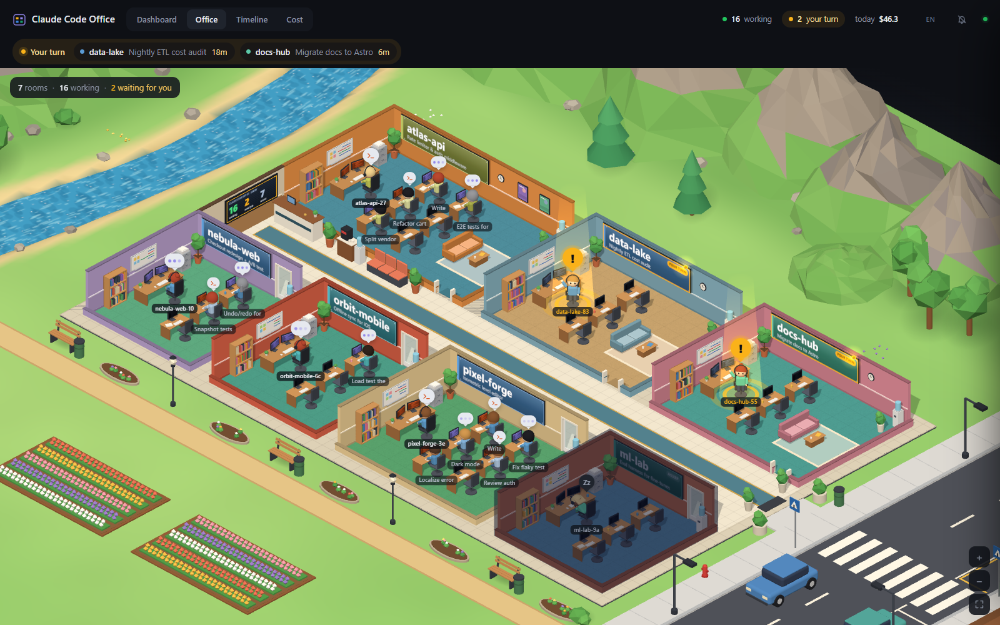
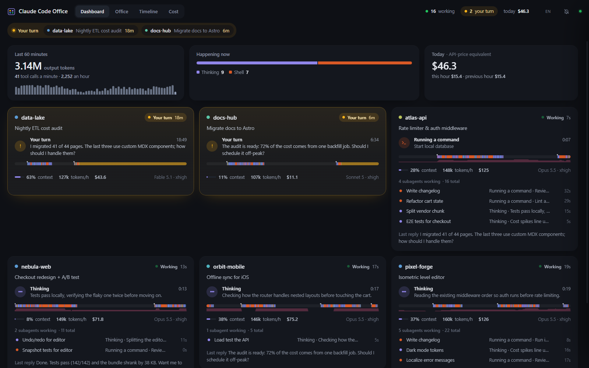
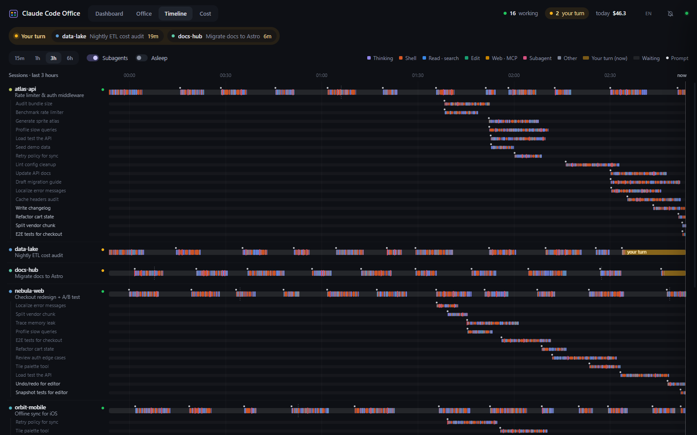
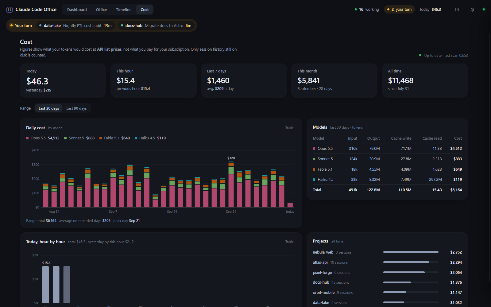
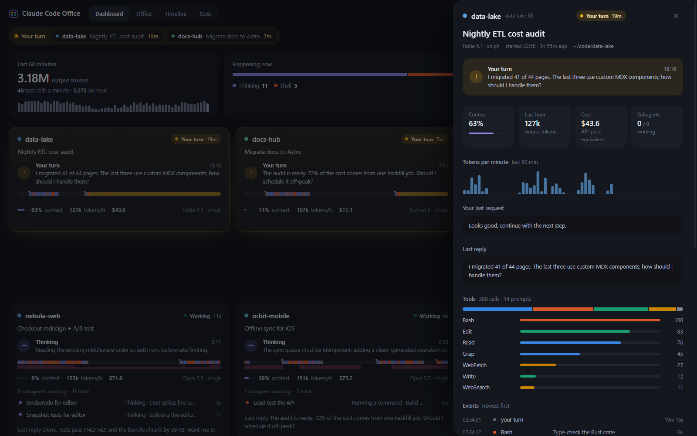

# Claude Code Office

**A live dashboard, 3D isometric office and cost tracker for your local Claude Code sessions and subagents.**
See at a glance which terminal is waiting for you, what every agent and subagent is doing right now, and what your usage would cost at API prices. Runs on `localhost`, reads your local Claude Code data, and can launch agents you approve step by step.

[](LICENSE)




```bash
node server.js
```
> Note: the `npx github:azorkai/claude-code-office` commands further down install the upstream project, which has no control panel. Run this fork with `node server.js`.

- Agents' Read/Glob/Grep inside the project folder run without asking; anything outside shows an approval card.
- Your own Claude settings (allow rules, hooks, plugins, MCP servers, skills) are ignored for these agents (`settingSources: []`), so none of them can bypass the approval cards. The project folder's own `CLAUDE.md` (any capitalisation, up to 40,000 characters) is read as plain text and appended to the agent's system prompt on every order, and the chat says "instrucciones del proyecto cargadas" when it does. Your global `~/.claude/CLAUDE.md` is not loaded. Note that a cloned repository's `CLAUDE.md` is instructions the agent will follow: treat it like code you trust.

That's it: the server starts on <http://127.0.0.1:7321> and your browser opens. No API key, no account, no setup.

> Just want to look? Run `npx github:azorkai/claude-code-office --demo` for a fictional, self-running office (it never starts agents).

---

## Why

If you run five, ten, fifteen Claude Code terminals at once, you lose track fast:

- *Which session finished and is waiting for my answer?*
- *What are those twelve background subagents actually doing?*
- *How big has that context grown, and how much would all of this cost on the API?*

Claude Code Office answers those questions live, from the data Claude Code already writes to `~/.claude`.

## Features

- **"Your turn" radar.** Sessions that finished and are waiting for you are pulled to the front, highlighted in amber and counted in the header and the tab title. An optional chime and desktop notification play when an agent hands the turn back.
- **3D isometric office.** It is a tycoon-game style building on a little diorama island, with streets, a river, trees and mountains. Every session is a room with its project name on the wall.
  - The lead agent sits at the big desk; subagents work at the other desks.
  - Monitors glow in the color of the current activity: thinking, shell, reading, editing, web/MCP or delegating.
  - New subagents walk in through the hall and leave when they finish. Idle rooms dim, and waiting rooms light up.
  - Street lamps and windows follow your local time of day.
  - The office drops to a low-power mode on machines without GPU acceleration.
- **Dashboard.** Each session card shows the current tool and elapsed time, a 30-minute activity strip, context-window fill, tokens per hour, session cost and live subagents.
- **Pinned rooms.** `pinned.json` in the data folder lists project folders that always get a room, even if hidden or inactive for more than 14 days. On first start it is created with the folder that contains the panel (the parent of this one). A pinned room never shows as asleep or as amber "your turn": while idle it shows as **Ready** (lights on, chief at the desk, neutral colour, not counted in the waiting total and no chime). Working or asking still show normally, and a live session in a pinned folder that is idle also shows as Ready. Pinned rooms cannot be hidden from the panel. **Manual switch:** with control (token) the chat header of every room has a **Sala activa / Sala inactiva** switch that pins or unpins that room (it also brings a hidden room back); it writes `pinned.json` for you. You can still edit the file by hand (a JSON array of absolute paths).
- **Timeline.** Swimlanes for every session and subagent over the last 15 minutes to 6 hours. It shows tool calls, thinking spans, waiting time, prompts and compactions, with hover details.
- **Cost tracker.** It converts every assistant message in your transcripts into dollars at API list prices:
  - today, this week, this month and all time
  - daily chart stacked by model, hourly chart for today
  - breakdowns per model and per project
  
  The first scan runs in a worker thread; after that only new bytes are read.
- **Drawer with details.** Click any agent to see its last prompt, recap, last reply, tool mix, per-minute tokens and full event log.
- **English and Turkish UI.** The language is detected from the browser and can be switched in the header.
- **Local, no telemetry.** It binds to `127.0.0.1` only and never writes to `~/.claude`. Its only runtime dependency is `@anthropic-ai/claude-agent-sdk`, used for the control panel.
- **Control panel.** Talk to one Claude Code agent per project from the dashboard and approve or reject each action (see below).

| Dashboard | Timeline |
|---|---|
|  |  |
| **Cost** | **Details** |
|  |  |

*All screenshots come from `--demo` mode (fictional projects).*

## Quick start

**One command (Node.js 18+):**

```bash
npx github:azorkai/claude-code-office           # start + open the browser
npx github:azorkai/claude-code-office --demo    # fictional demo office
```

**From source / double-click:**

```bash
git clone https://github.com/azorkai/claude-code-office.git
cd claude-code-office
npm start            # or double-click start-windows.bat  (macOS/Linux: ./start-macos-linux.sh)
```

**Options:**

| Flag | Default | What it does |
|---|---|---|
| `--port <n>` | `7321` | Port to listen on (always `127.0.0.1`) |
| `--open` / `--no-open` | open | Open the browser after start |
| `--demo` | off | Fictional data; does not read `~/.claude` and never starts agents |
| `--claude-dir <dir>` | `~/.claude` or `$CLAUDE_CONFIG_DIR` | Where Claude Code keeps its data |
| `--data-dir <dir>` | `~/.claude-code-office` | Where the cost cache is stored |

## How it works

| Source | What it gives |
|---|---|
| `~/.claude/sessions/<pid>.json` | Live sessions and whether each one is busy or idle (the process must still be alive) |
| `~/.claude/projects/**/<sessionId>.jsonl` | The transcript: prompts, tool calls and results, token usage, titles, recaps |
| `…/<sessionId>/subagents/agent-*.jsonl` + `.meta.json` | Every subagent's own transcript, type and task description |

The server tails these files once per second. It reads only the last few MB of long transcripts on first start, then only the new bytes. It turns the records into agent states and events, and streams them to the browser over Server-Sent Events. Nothing is uploaded anywhere.

## Control panel (agents you can talk to)

Besides watching, the panel can start a Claude Code agent inside a project's folder (via `@anthropic-ai/claude-agent-sdk`) and let you chat with it.

- **Control token.** At every start the server generates a random token and prints a link like `http://127.0.0.1:7321#t=<token>`. Open that link to give orders. Without `#t=` the page is a read-only viewer, and the chat and approval events are not streamed to it.
- **Local only.** The server binds to `127.0.0.1` and checks the `Host` and `Origin` headers.
- **Chat.** The reply streams in live with formatting. Each tool call shows as a collapsible step, followed by its result.
- **Approvals.** `Read`, `Glob` and `Grep` inside the project folder run without asking. Everything else (edits, commands, connectors) shows an **Aprobar / Rechazar** card with the full command or path. No answer in 10 minutes counts as rejected.
- **Mode, model and effort.** Selectors next to the input: mode **Pedir permiso**, **Plan**, **Aceptar ediciones**, **Auto** or **Sin preguntar**; model default, Sonnet, Opus or Haiku; effort default, low, medium, high, xhigh or max. They apply from the next order, not to one already running.
  - In **Aceptar ediciones**, file edits inside the project show no card, and neither do file-system Bash commands such as `rm`, `mv` or `cp` inside the project (observed live: `rm` ran with no card); other Bash commands and everything else still ask.
  - **Auto** is Claude Code's automatic mode (a classifier decides, per the SDK typings, which calls run and which still prompt); no confirmation is needed. Cards still appear when it cannot decide.
  - **Sin preguntar** (`bypassPermissions`) never asks: the agent can read and write anywhere your user can on disk and run any command, with no cards. The page shows a red warning while it is selected. The server enforces the confirmation: the order is only run in this mode if the request carries `confirmed: true` (the page sends it after you accept a dialog, once per project per page load); otherwise it silently falls back to **Pedir permiso**, and the chat says so. It is never remembered: after a reload the mode comes back as the last other mode you chose. The don't-ask mode (`dontAsk`) is not reachable.
  - Every run starts with a chat line stating the effective mode (`modo: ...`), and the server logs a line when the mode is Auto or Sin preguntar.
  - The mode (except Sin preguntar), model and effort are remembered per project in your browser.
- **History.** The server keeps up to 300 events per project in memory and sends them only to clients that have the token. After a restart it rebuilds each room from the saved Claude conversation (the transcript of the last session id in `agents.json`), again up to the last 300 events. Not restored: rooms that never received orders from the panel (no saved session), runs older than the last saved session (unless Claude copied them into the newer one), and live streaming deltas or token counts.
- **Compaction.** When Claude compacts the conversation, the chat shows a "Conversación compactada" divider. The **Compactar** button (shown when you have control and the room is idle) sends `/compact` as a normal order; it is refused if the project has no saved conversation. Checked live through the SDK on a resumed session: `/compact` runs and reports the before/after size (one test went from about 35k to 4k tokens), shown in the divider.
- **Specialist agents per room.** `rooms.json` in the data folder (never inside a project folder, so a cloned repo cannot give itself agents) maps a project folder to a directory of agent `.md` files: `{ "<folder>": { "agentsDir": "room-agents/seguridad" } }`, relative to the data folder. Every `.md` there becomes a subagent of that room's agent (same name, description and instructions, at most 60 files). Only text is used: the file's `model`, `permissionMode`, hooks, MCP servers, memory and skills are ignored, and the tool list is reduced to built-in names, so an agent file cannot widen what the approval cards guard. A subagent's tool calls go through the same cards (checked live: a subagent's `Write` raised an approval and was denied). The chat says "agentes de la sala cargados: N". The **Seguridad** room (`Desktop\Seguridad`, pinned) ships with 14 security agents copied from `wshobson/agents` (see `SOURCE.txt` in its folder); add or remove files to change the team.
- **Not included.** No `/` command menu, no attachments, and no skills, hooks or MCP connectors from your own settings.
- **Your settings are ignored for these agents.** Allow rules in your own Claude settings do not apply (`settingSources: []`), and the only modes that skip cards are the opt-in Auto and Sin preguntar above.
- **Limits.** 30 turns max per order, one order at a time per project.
- **Cost.** Launched agents write their transcripts like any Claude Code session, and every order consumes your Claude plan.
- **Rooms.** Projects with activity in the last 14 days get dormant rooms, grouped by parent folder. You can hide them; hidden projects are stored in `~/.claude-code-office/hidden.json` and agent session ids in `~/.claude-code-office/agents.json`.

## About the cost numbers

The cost view shows what your token usage **would cost at Anthropic API list prices**. If you use Claude Code with a Pro/Max subscription, this is **not your bill**. It is a way to see how heavy your usage is and where it goes.

- Every assistant message's `usage` is priced as input + output + cache writes (5 min = 1.25× input, 1 h = 2× input) + cache reads, per model.
- Messages are de-duplicated by message id, so streamed records are not double-counted.
- Transcripts that Claude Code has already deleted cannot be counted, so totals start at your oldest transcript.
- Prices are in [`cost-worker.js`](cost-worker.js); update them there if Anthropic changes its pricing.

## Configuration (optional)

Create `~/.claude-code-office/config.json`, or `config.local.json` next to `server.js`. Both are git-ignored.

```json
{
  "port": 7321,
  "open": true,
  "dataDir": "~/.claude-code-office",
  "projectColors": { "my-app": "#5B9BD5", "api": "#E08A6E" },
  "projectColorsFile": "~/project-colors.json",
  "cswapUrl": "http://127.0.0.1:7317/api"
}
```

`cswapUrl` is optional. It points to a local endpoint that reports per-account 5-hour/7-day usage, and the header shows it as small bars. Leave it out if you do not have one.

## Embed it into your own site

The server is also a plain request handler, so you can mount it into an existing Express/Connect app:

```js
const { createOffice } = require('./claude-code-office/server.js');

const office = createOffice({
  site: { name: 'My Portal', home: '/', links: [{ label: 'Home', href: '/' }, { label: 'Agents', href: '/agents/', current: true }] },
});
office.start();
app.use('/agents', office.handler);   // everything uses relative URLs, so any mount path works
```

When `site` is given, the page shows your site's navigation bar on top, so both apps feel like one site.

## FAQ

**Does it send my code or prompts anywhere?**
No. It only listens on `127.0.0.1`, reads files under `~/.claude` and serves them to your own browser.

**Windows, macOS, Linux?**
All three. It needs Node.js 18 or newer.

**Does it need an API key or Claude Code plugins?**
No. It reads the files Claude Code already writes.

**Does it slow Claude Code down?**
No. It never writes to `~/.claude` itself, and it only reads new bytes after the first pass. Agents you launch from the panel are normal Claude Code sessions and write their own transcripts there.

---

## Türkçe

**Claude Code Office (Ajan Ofisi)**, bilgisayarında aynı anda çalışan Claude Code oturumlarını ve alt ajanlarını canlı gösteren yerel bir paneldir:

- hangi terminalin seni beklediğini ("Sıra sende")
- her ajanın şu an ne yaptığını
- bağlamın ne kadar dolduğunu
- kullanımının API liste fiyatıyla ne tuttuğunu

Görünümler:
- **Pano:** oturum kartları.
- **Ofis:** her oturumun bir oda olduğu 3D izometrik bina.
- **Akış:** oturum ve alt ajan kulvarlarında zaman çizelgesi.
- **Maliyet:** günlük ve saatlik grafikler, model ve proje kırılımı.

```bash
npx github:azorkai/claude-code-office          # başlat ve tarayıcıyı aç
npx github:azorkai/claude-code-office --demo   # uydurma verili demo ofis
```

- Yalnızca `127.0.0.1`'e bağlanır, `~/.claude` altına kendisi yazmaz, hiçbir yere veri göndermez.
- Kontrol paneli: sunucunun yazdığı `#t=` bağlantısıyla proje başına bir ajan başlatabilir; düzenleme ve komutlar için Aprobar/Rechazar kartı çıkar, 10 dakika yanıtsız kalırsa reddedilir.
- Arayüz dili tarayıcıya göre seçilir, üst çubuktan değiştirilebilir.
- Maliyet rakamları aboneliğinle ödediğin tutar değil, aynı kullanımın **API liste fiyatıyla karşılığıdır**.

---

MIT © azorkai. Not affiliated with or endorsed by Anthropic. "Claude" and "Claude Code" are trademarks of Anthropic, PBC.

- **Vigilancia sin IA** (lib/monitor.js): cada 30 min (env OFFICE_MONITOR_MIN) revisa los proyectos con git y avisa en su sala si un cambio sin commitear tiene un posible secreto o si un .env no esta en .gitignore. No imprime valores. Avisa una vez por hallazgo (monitor-seen.json).

- **Sala de Seguridad de ejemplo**: ver `ejemplos/sala-seguridad/LEEME.md`.

- **Memoria con Obsidian**: ver `docs/obsidian-memoria.md` y la plantilla en `ejemplos/obsidian/`.
